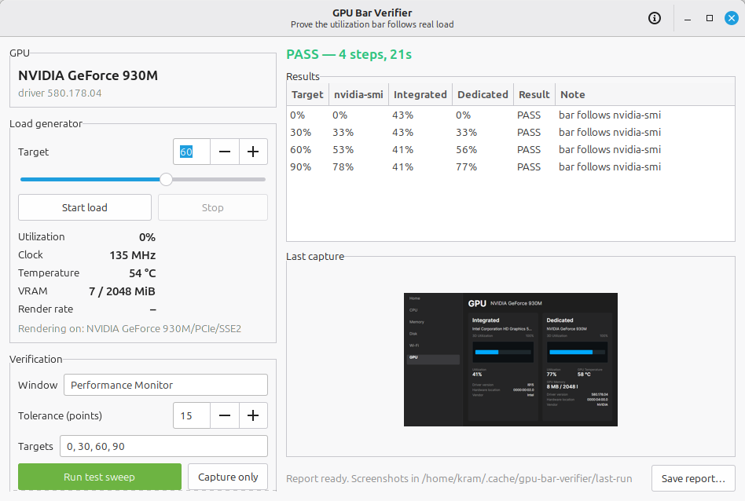

# GPU Bar Verifier

Prove that a GPU utilization bar follows **real hardware load** — not just that
the number is bound to the right property.



On hybrid laptops (Intel iGPU + NVIDIA dGPU in PRIME `on-demand` mode) the
discrete GPU is genuinely idle most of the time, so its utilization bar sits at
0%. That looks exactly like a broken UI. This tool settles the question: it puts
a *controlled*, adjustable load on the GPU and checks — from the rendered
pixels — that the bar fills to match what `nvidia-smi` reports.

## What it does

1. **Generates a controllable load** on the discrete GPU: a GL 3.3 fragment
   shader rendering into an offscreen pbuffer, duty-cycled to a target
   percentage. Nothing appears on screen; the compositor keeps running on the
   integrated GPU.
2. **Reads the same source the app under test reads** (`nvidia-smi`), so a
   disagreement means the UI is wrong, not that two counters disagree.
3. **Captures the target window** over X11 and locates the utilization bars by
   their colours.
4. **Measures the painted fill** in pixels and compares it with the hardware
   reading, per step, with a PASS/FAIL verdict, a monotonicity check, JSON
   report and screenshots.

## Requirements

| | |
|---|---|
| OS | Linux with X11 (XWayland works if the target app is an X11 client) |
| Python | 3.9+ |
| Python packages | `Pillow` (required), `PyGObject` (GUI only) |
| Hardware | any GPU for the load generator; `nvidia-smi` for the dedicated-GPU comparison |
| Optional | `nvidia-smi` from the NVIDIA driver |

Debian / Ubuntu / Linux Mint:

```bash
sudo apt install python3-gi gir1.2-gtk-3.0 python3-pil
```

## Install

```bash
./install.sh              # into ~/.local (bin, desktop entry, icon)
./install.sh --uninstall  # remove it again
```

Or run straight from the checkout, no installation:

```bash
./bin/gpu-bar-verifier
```

## Usage

### GUI

```bash
gpu-bar-verifier
```

Open the GPU page in the app you want to test, then press **Run test sweep**.
The left panel also has a manual load slider with live `nvidia-smi` telemetry,
and **Capture only** measures the current state without generating load.

### CLI

```bash
# full sweep, screenshots and a JSON report
gpu-bar-verifier verify --targets 0,30,60,90 --settle 5 \
    --shots ./shots --json report.json

# just load the GPU at 60% for 30 s
gpu-bar-verifier load --target 60 --duration 30

# measure the bars right now (no load)
gpu-bar-verifier capture --window "Performance Monitor" --out shot.png
```

Exit codes: `0` pass, `1` fail, `2` error (window missing, no display, …).

Example:

```
target  nvidia  integrated  dedicated  result  note
------  ------  ----------  ---------  ------  ----
     0%      0%       43%         0%  PASS  bar follows nvidia-smi
    30%     33%       43%        33%  PASS  bar follows nvidia-smi
    60%     53%       41%        56%  PASS  bar follows nvidia-smi
    90%     78%       41%        77%  PASS  bar follows nvidia-smi

RESULT: PASS (4 steps, 21s)
```

## How the load control works

`nvidia-smi` reports utilization as *time spent busy*, so intensity does not
matter — only the fraction of wall time the GPU is working. The generator
renders for a slice of each cycle and idles for the rest:

```
cycle (20 ms) = busy(target%) + idle
```

A frame costs a few milliseconds on a small GPU, so a naive "render for N ms"
loop overshoots badly at low targets. The generator carries the error into the
next cycle, which converges on the requested average instead of drifting.

The cycle is deliberately short (20 ms): older NVIDIA drivers sample
utilization over roughly 1/6 s, and a 100 ms cycle made single readings swing
by ±30 points. At 20 ms the readings are stable within a few points, which is
what makes a meaningful comparison possible.

## How the measurement works

* Bars are found by colour: the trough (`#1E272C`) and the fill (`#00A8FF`).
  The trough is very close to the card background (`#252526`), so the track test
  also requires the slight blue shift; otherwise every row of the window looks
  like a bar.
* A bar row is any row containing a long run of track-or-fill pixels, so a
  100%-full bar (no trough left) is still detected. Consecutive rows form a
  band; the band's middle row is measured, avoiding the antialiased rounded
  ends.
* The window is raised (EWMH `_NET_ACTIVE_WINDOW`) and checked for occlusion
  before grabbing, because a screen grab of a covered window silently returns
  someone else's pixels.
* GTK client-side-decoration shadows (`_GTK_FRAME_EXTENTS`) are cut off, so the
  crop contains only the app's own content.
* Colours are configurable via `BarStyle`, so the tool works on other themes and
  applications.

## Reading the results

| Note | Meaning |
|---|---|
| `bar follows nvidia-smi` | bar matches the hardware reading within tolerance |
| `bar off by +N pts` | the painted bar disagrees with `nvidia-smi` — real bug |
| `GPU busy but bar stays empty` | utilization > 5% and the bar is blank — the reported problem |
| `GPU idle but bar is painted` | stale value never cleared |
| `dedicated bar not found` | the app is not on its GPU page, or the window is wrong |
| `bar went down while load rose` | monotonicity failure across steps |

`--tolerance` (default 15 points) absorbs the sampling noise of `nvidia-smi`
itself; the painted width is measured to ~0.5%.

## Limitations

* X11 only. On Wayland the target must run through XWayland.
* The target app must be showing its GPU page, and its bars must use the
  configured colours (defaults match the Performance Monitor theme).
* The load generator targets one GPU; on a single-GPU machine the system stays
  responsive but the desktop may stutter at 100%.
* It is a verification tool, not a benchmark: absolute numbers are not
  meaningful, only the agreement between hardware and UI.

## Tests

The bar measurement is covered by unit tests that need no GPU, no X server and
no target application:

```bash
python3 -m unittest discover -s tests -v
```

## License

MIT — see [LICENSE](LICENSE).
